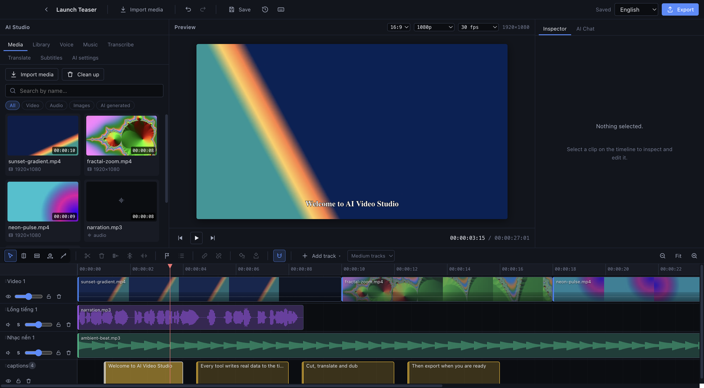
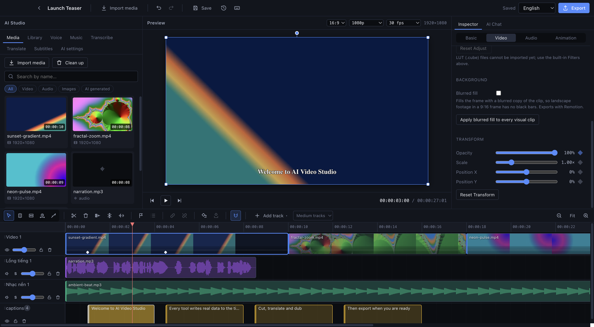
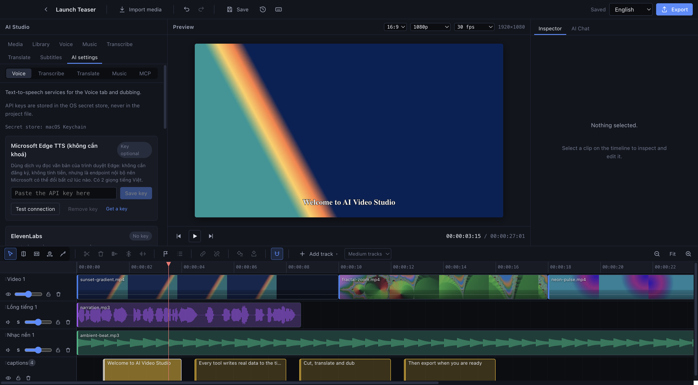
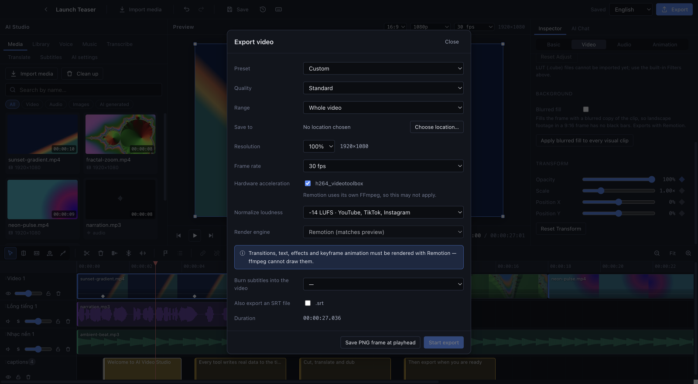

# AI Video Studio

**English** | [Tiếng Việt](README_VI.md)

A local desktop video editor with a multi-track timeline and a Vietnamese interface (English also
available), designed so that AI tools — transcription, translation, dubbing, subtitles — produce
**real data on the timeline** instead of a frozen video.

> **Status: Milestones 1 and 2 are complete.**
> Importing media, building a timeline, previewing, saving/reopening and exporting MP4 all work for real.
> Voice-over **runs end to end against the real ElevenLabs API**: enter a key into the Keychain, fetch
> models and voices from the account, generate Vietnamese audio, measure its duration with ffprobe,
> and get a clip on the timeline that can be cut and undone. See [Current scope](#current-scope).

---

## Screenshots



| | |
|---|---|
|  |  |
| **Inspector and keyframes** — set keyframes with the diamond buttons; they appear as dots on the clip | **Subtitles** — cues are editable in the panel and live as blocks on the timeline |
|  |  |
| **Voice-over** — pick a provider, model and voice, with parameters that follow the model | **AI settings** — keys go to the OS secret store; a missing key disables only what depends on it |
|  | |
| **Export** — presets, quality, range, loudness normalization, subtitle burn-in | |

The sample footage in these screenshots is synthetic, generated with ffmpeg.

## License

AGPL-3.0-or-later (see `LICENSE`). This project reuses WebGL code from
[OpenChatCut](https://github.com/onlook-dev/OpenChatCut) for the two-stream transition path, and
OpenChatCut is AGPL — so this project must be AGPL too. The exact list of copied parts is in `NOTICE`.

The obligation that comes with it: anyone who receives a distribution — even if only through network
access — has the right to request the corresponding source code.

## System requirements

| Component | Version | Notes |
|---|---|---|
| Node.js | ≥ 22 (tested on 24.20) | `nvm use` reads `.nvmrc` |
| npm | ≥ 10 | npm 11 blocks install scripts by default, see below |
| Operating system | macOS (tested on Apple Silicon) | Windows/Linux not verified |

**You do not need to install ffmpeg.** The app uses the ffmpeg/ffprobe builds bundled through npm.
This is deliberate: Homebrew's ffmpeg on macOS is often built **without libass**, which means no
`subtitles` filter, and subtitle burn-in would fail silently.

## Install and run

```bash
nvm use                 # Node 22+
npm install
npm run dev             # open the app in development mode
```

If npm reports `packages have install scripts not yet covered by allowScripts`, run the following and
install again — Electron and ffmpeg need install scripts to download their binaries:

```bash
npm install-scripts approve electron ffmpeg-static @ffprobe-installer/darwin-arm64 esbuild
npm install
```

### Other commands

```bash
npm run build        # type-check + bundle into out/
npm start            # run the built app
npm test             # unit + integration (runs real ffmpeg)
npm run test:e2e     # build, then run end-to-end tests on real Electron
npm run typecheck
npm run lint
```

## Where data is stored

```
<userData>/projects/<project-id>/
├── project.json     project document (has a schemaVersion for migrations)
├── media/           app-managed media
├── cache/           thumbnails, filmstrips, waveforms — safe to delete, regenerated on demand
└── versions/        autosave snapshots
```

On macOS, `<userData>` is `~/Library/Application Support/ai-video-studio`.

This folder name is **deliberately different** from the app's display name ("AI Video Studio"). By
default Electron derives the data folder from the app name, so changing the display name would move
the folder and every saved project would vanish from the app — they would still be on disk, the app
just would not look there anymore. The folder name is a data concern and the display name is a UI
concern; the two are kept fully separate.
Set `AVS_USER_DATA_DIR` to use another folder (the end-to-end tests use this to run on an empty profile).

**Source files are never copied or modified.** A project only keeps references to the original paths,
so no editing operation is destructive to the originals.

## Keyboard shortcuts

| Key | Action |
|---|---|
| `Space` | Play / pause |
| `←` `→` | Step back/forward one frame (hold `Shift` to jump 10 frames) |
| `S` | Split the selected clip at the playhead |
| `Delete` | Delete the selected clip |
| `Shift+Delete` | Ripple delete: remove the clip and pull later clips on the same track forward |
| `M` | Add a marker at the playhead |
| `?` | Open the shortcuts list (there is also a "Shortcuts" button in the top bar) |
| `Shift+M` / `Cmd+Shift+M` | Next marker / previous marker |
| `Cmd/Ctrl+Z` | Undo (add `Shift` to redo) |
| `Cmd/Ctrl+D` | Duplicate clip |
| `Cmd/Ctrl+G` | Group the selected clips (add `Shift` to ungroup) |
| `Shift`+click | Add a clip to the selection — dragging one clip moves the whole selection |
| `+` `-` | Zoom the timeline in / out |
| `Home` | Go to the start of the timeline |
| `Esc` | Clear selection |

Shortcuts do **not** fire while the cursor is in an input field.

---

## Current scope

### Working and verified

- **Projects**: create, open, delete, autosave, reopen in the exact state, version snapshots, versioned schema
- **Media**: import video/audio/images, read metadata with ffprobe, generate real thumbnails +
  filmstrips + waveforms, prevent duplicate imports by content hash, detect missing media
- **Timeline**: multiple video/audio tracks, drag and drop from the library, move, trim, split,
  duplicate, delete, snapping (clip edges + playhead + frame grid), zoom, hide/mute/solo/lock tracks
- **Preview**: play, pause, seek, frame stepping, layering multiple clips, mixing audio from multiple
  tracks, timecode, synchronized by a single master clock
- **Keyframes**: let a property change over time instead of holding one value for the whole clip.
  Covers clip transform (x, y, scale, rotation, opacity), effect intensity + **numeric** effect
  parameters, and the position / font size / rotation of text overlays. Set them with the diamond
  button in the Inspector panel, drag/delete/change interpolation on the dot strip under the clip,
  or by instructing the agent. Five interpolation types: linear, hold, ease in, ease out, ease in-out.
  Keyframes follow the clip through trims, splits, speed changes and duplication — and **reach the
  exported file**, verified at pixel level
- **Transcription**: local whisper.cpp with word-level timestamps, transcript editor with click-to-seek
- **Translation**: keeps per-segment links, per-segment editing, glossary, via an OpenAI-style LLM server
- **Subtitles**: create from a transcript or translation, bilingual, text style presets, **import
  existing `.srt`/`.vtt` files**, burn into the video and export a separate SRT
- **Dubbing from a translation**: measures real durations, detects overruns, offers three ways out,
  never cuts speech
- **AI Chat and MCP**: the agent reads the project and edits through the same command set as the
  UI; external agents (Claude Code) connect through an MCP server on loopback
- **Auto-ducking**: lowers background music during speech using volume keyframes — smooth ramps, no clip cuts
- **Keyframes**: clip transform, clip volume, numeric effect parameters, text overlay
  position/size/rotation; five interpolation types; copy/paste keyframe sets between clips
- **Copy/paste clips** with Cmd+C / Cmd+V, keeping every property
- **Freeze frame**: freezes the frame at the playhead for 2 seconds (drag the edge to extend up to
  10 seconds); what follows on the clip's lane and group shifts along; the frame is built exactly
  from the source frame
- **Duplicate project** from the project list — also copies app-generated media, so the copy stands on its own
- **Auto-measured silence threshold** when cutting silences: measures the clip's own noise floor
  instead of a fixed -35 dB
- **Short-form export**: blurred background behind the clip (a landscape shot in a 9:16 frame no longer
  gets black bars; applies to one clip or all clips); export presets for TikTok·Reels·Shorts /
  YouTube / Instagram square; three quality levels; export a range (between two markers or chosen
  seconds); save a PNG frame at the playhead as a cover image — rendered with the same composition,
  so it matches the video pixel for pixel. The agent uses `set_background_fill`, `export_frame` and
  `start_export` with range/quality
- **Voice cleanup** (Audio tab): removes hum below 80 Hz and reduces background noise (`afftdn`,
  which tracks the noise floor by itself), three levels. Outputs a new FLAC file — the original is
  untouched and lip sync does not drift. For a video clip with sound, the clean audio is added on the
  dialogue lane, grouped with the clip, and the original audio is muted
- **Loudness normalization on export**: two-pass `loudnorm` to -14 LUFS (YouTube, TikTok, Instagram)
  by default, or -16 / -23 / off; copies the video stream as is, works with both renderers
- **Silence cutting**: finds silent spots in the selected clip's audio with ffmpeg `silencedetect`
  (no transcription needed), reports up front how many seconds will be cut, leaves breathing room
  around speech; choose to shrink only the clip's track (background music stays put) or the whole
  video (subtitles, text and markers move along)
- **Version restore**: the Versions button in the top bar lists automatic snapshots (every 5 minutes)
  and manual saves; restoring always snapshots the current state first, so a wrong restore can be reverted
- **Ripple delete** for clips (button + `Shift+Delete`): deletes and pulls later clips **on the same
  track** forward — other tracks stay put, same rule as ripple trim
- **Markers**: add with `M`, drag to move, double-click to name/color/delete, jump between them with
  `Shift+M`; **copy a YouTube-style chapter list** to the clipboard. The agent uses `add_marker` /
  `update_marker` / `remove_marker` / `ripple_delete_clip`
- **Drag multiple clips at once** (even across tracks, keeping their spacing) and **clip groups**:
  clicking a clip selects its whole group, moving one clip moves the group; trim/speed/effects still
  apply per clip. The agent can use `group_clips` / `ungroup_clips` / `move_clip`
- **Relink missing media**, and change the aspect ratio / frame rate after a project is created
- **Undo/redo**: patch-based, a group of commands makes a single undo step
- **Export**: MP4 (H.264 + AAC), choice of resolution and fps, hardware acceleration where
  available, real progress from ffmpeg, cancel midway, subtitle burn-in, separate SRT export
- **Language**: Vietnamese by default, switches to English instantly
- **AI settings**: API keys stored with `safeStorage` (macOS Keychain), connection test, key
  removal; a missing key disables only the features that depend on it
- **Self-hosted TTS servers**: works with any server offering `POST /v1/audio/speech` —
  omnivoice-server (wrapping OmniVoice), Piper, Coqui XTTS, openedai-speech, Kokoro… No key needed,
  no API fees, data never leaves the machine
- **Voice-over**: choose provider/model/voice, voice and model lists come **straight from the
  account**, split a script into segments that can be regenerated individually, insert at the playhead /
  on a new track / replacing the selected clip. AI-generated audio is a real asset: it has a waveform,
  a duration measured by ffprobe, and can be cut and undone
- **Background music**: load music, insert it on a music track, adjust volume and fades — **no AI key required**
- **Background jobs**: queue with full status, real cancellation, reuse of previous results on retry

### Not implemented

No tab in the interface is an empty shell. The following do not exist yet, for specific reasons:

- **Speaker diarization** — whisper.cpp cannot do it; waiting for a provider with real diarization
- **Importing `.cube` LUT files** — SVG filters cannot apply a 3D lookup table; doing it properly
  means pushing each frame through a shader. Built-in color looks do exist (Filters tab, 16 looks)
- **WebGL-dependent effects**: ASCII, kaleidoscope, fisheye, halftone, per-color-range HSL
- **Object tracking, multi-camera, AI video generation** — see the backlog in `docs/project-roadmap.md`

### Verified against the real API (ElevenLabs)

The whole flow runs through the real UI, with 7 end-to-end tests calling the real API: enter the key
into the Keychain → test the connection → fetch models and voices from the account → **generate
Vietnamese audio** → asset lands in the library with a duration measured by ffprobe → insert as a
clip → cut → undo → regenerating reuses the previous result without creating a duplicate asset.

Running it for real fixed **seven** mistakes that fixture-based tests could not catch — because
fixtures only re-assert the same assumptions that were wrong in the first place:

| What was wrong | Hand-written table from the docs | What the API actually says |
|---|---|---|
| Model for Vietnamese | `eleven_multilingual_v2` | That model does **not** have `vi`; use `flash_v2_5`, `turbo_v2_5` or `v3` |
| `eleven_v3` limit | 3,000 characters | 5,000 |
| `style` / `speaker_boost` | on for every model | `can_use_style` / `can_use_speaker_boost` flags **per model** |
| Voice language codes | used as is | **duplicated** (one voice has `en` nine times) — must be deduplicated |
| Missing key permissions | lumped into "wrong key" | 401 with `missing_permissions` is a **completely different** case: the key is valid, it just lacks permissions |
| Filtering voices by language | hard filter | Of 23 voices only 2 are verified for Vietnamese, and neither is **usable** on the free plan — a hard filter hid 21 voices that still read Vietnamese well. Now they are only **flagged + sorted first** |
| Account plan | ignored | "Library" voices get **HTTP 402** on the free plan; the UI warns up front |

That is why model metadata is now **read from `/v1/models`** rather than hard-coded.

### Known limitations

- **OpenAI TTS has never been called for real.** The adapter was written from the docs and tested
  with fixtures; there has been no OpenAI key to confirm it.
- **The real omnivoice-server has not been tried.** Running it needs PyTorch and a multi-GB model
  download. The adapter is tested against a real HTTP server set up in the tests, speaking the
  protocol as that project documents it — but it is unconfirmed that omnivoice-server behaves as documented.
- **Voice cloning is not supported.** Self-hosted servers use different field names (`ref_audio`,
  `speaker_id`, file paths) and there is no common standard yet; the adapter only commits to the core
  that every server has.
- **"Library" voices need a paid plan.** Free accounts are rejected with HTTP 402 when using
  `professional` voices. The UI marks voice categories and warns up front.
- **Filtering voices by language is only a hint.** It filters on a voice's "verified languages", but
  multilingual models can still read other languages — the UI says so explicitly.
- ElevenLabs' `speed` parameter is **not exposed in the UI** because its valid range could not be
  verified. Duration stretching for dubbing will use ffmpeg's `atempo`, independent of the provider.
- **A few common editing operations are missing**, reviewed and written down so nobody has to look
  for them again: ripple delete is agent-only, with no UI button yet; no markers/chapters, individual
  clips cannot be locked, clips cannot be grouped; with multiple clips selected, dragging and the
  Inspector panel still act on the first clip only; waveforms do not show on video clips with audio.
- **Building cuts from speech and from shots is agent-only** (`build_cut_from_transcript`,
  `build_cut_from_shots`) — there is no UI button yet, even though shot detection already works for real.
- **Export is MP4/H.264 only with fixed quality**: no presets, no export of just the selected range,
  no queue for multiple renders.
- **Tested on macOS Apple Silicon only.** Windows/Linux have never been run.
- **The macOS installer builds, but cannot be released yet.** `npm run build:mac` produces a `.dmg`
  that runs on the machine that built it. Two things block handing it to others: the build is not
  **notarized** (`notarize: false`, needs a Developer ID), so Gatekeeper blocks it on other machines;
  and the bundled ffmpeg is built with `--enable-nonfree`, so it **cannot be redistributed** — it must
  be replaced with a license-compliant build first. Windows/Linux have configs but have never been built.
- **Projects with keyframes must export through Remotion**, and the Export dialog locks that choice.
  The ffmpeg filter graph reads transforms as constants, so it would produce a static file without
  saying anything. Remotion is considerably slower — that is the price of not losing the motion.
- **Keyframes do not yet cover**: color grading, text box padding, filter (LUT) intensity. **Color and
  choice** effect parameters cannot be animated either — "a color between two colors" and "a choice
  between two choices" are entirely different problems, not an oversight.
- **No custom bezier curves** for keyframes (the five built-in interpolation types do exist).
- **Clip speed** is saved and exported correctly, but the preview does not pitch-stretch audio yet.
- **Volume above 100% is only audible in the exported file.** The browser's media elements accept
  only 0..1, so the preview cannot go louder than 100%; the UI says so right below the slider. A louder
  preview would need a WebAudio graph for the playback layer.
- Double-clicking an audio clip currently inserts it on the first empty audio track; drag and drop
  lets you choose the exact track.

---

## Architecture

```
src/
├── shared/        shared by both processes — no Electron dependency
│   ├── domain/    project schema, time conventions, composition resolver
│   ├── commands/  editing command set, pure reducer, patch-based undo history
│   ├── ai/        provider capability declarations, per-task-group interfaces
│   ├── jobs/      background job lifecycle
│   └── ipc/       contract between renderer and main
├── main/          Node process: disk, child processes, ffmpeg, API keys
│   ├── media/     probe, hash, waveform, thumbnail, media scheme
│   ├── storage/   atomic project writes, folder layout
│   ├── export/    builds the filter graph, runs jobs, writes ASS/SRT
│   ├── ai/        provider adapters, error-classifying HTTP layer, registry
│   ├── jobs/      queue, result cache keyed by request fingerprint
│   ├── secrets/   key storage via safeStorage
│   └── ipc/       handlers
├── preload/       contextBridge bridge (CommonJS, runs in the sandbox)
└── renderer/      React UI
```

Five decisions shape the rest:

1. **Time is integer microseconds and positions are always absolute.** Nothing accumulates, so
   rounding error can never build up. Conversion to frames happens in only two places: when snapping
   and when exporting.

2. **Every change goes through one validated command set.** Manual edits and AI edits share exactly
   one write path. AI is not allowed to write JSON straight into a project — it only emits commands,
   and commands must pass the schema. A transaction mechanism folds a group of changes into one undo step.

3. **Preview and export read the SAME composition resolver** (`shared/domain/composition-resolver.ts`).
   There are no two sources of truth about the timeline, so the preview cannot drift from the export.

4. **The renderer never touches the disk or child processes.** It runs in a sandbox and only talks
   through preload. API keys live entirely on the main side: the renderer can only ask "does this
   provider have a key yet", and there is no path to read a key's value back.

5. **The AI parameter UI is built from each provider's capability declarations**, not hard-coded. If
   a model does not accept a parameter, that field does NOT exist, rather than being grayed out.

See [`docs/system-architecture.md`](docs/system-architecture.md) for details.

## Testing

| Type | Count | Content |
|---|---|---|
| Unit | 46 | Time conversion, timeline transforms, command transactions, payload validation, job lifecycle, script segmentation |
| Integration | 24 | **Runs real ffmpeg**: probe, waveform, thumbnail, export command building, MP4 rendering, subtitle burn-in, job cancellation |
| Adapter (fixture) | 18 | Fake server returning responses of the real shape: correct path/header/body building, pagination, per-model parameters, error classification |
| Real provider | 7 | **Calls real ElevenLabs** at the adapter layer. Runs only when `ELEVENLABS_API_KEY` is set |
| Real provider end-to-end | 7 | **Whole flow through the UI with the real API**: key → voice → generate audio → clip → cut → undo |
| Self-hosted server | 21 | 16 unit + 5 end-to-end running against a **real HTTP server** set up in the tests, returning real WAV audio |
| Keyframes | 96 + 15 | 96 unit for interpolation, transforms on trim/split, drawing paths, agent tools; 15 end-to-end for the diamond button and the timeline dot strip |
| End-to-end | 28 specs | **Runs the real built Electron app**: import media, build a timeline, cut, undo, switch language, save/reopen, export MP4 and inspect it with ffprobe, store keys through the real keychain, parameters changing per model, background music working with no key |

```bash
npm test          # 960 passed + 21 skipped (real API group)
npm run test:e2e  # 228 passed + 12 skipped (real API group)

# Full run including the real provider calls — keys are NEVER written to the repo:
ELEVENLABS_API_KEY=... npx vitest run
ELEVENLABS_API_KEY=... npx playwright test
```

The tests deliberately **do not mock ffmpeg**: the value lies in whether the command-line arguments
are correct, and that is exactly the part a mock would hide.

## Using self-hosted TTS (OmniVoice and other servers)

The app speaks the OpenAI-style `POST /v1/audio/speech` protocol — the de facto standard of the
self-hosted TTS ecosystem. So **one provider serves them all**, rather than one adapter per project.

### OmniVoice

[k2-fsa/OmniVoice](https://github.com/k2-fsa/OmniVoice) supports 646 languages, including **8,481
hours of Vietnamese training data**. The official repo ships no HTTP server (only a Gradio demo and a
Python SDK), so a wrapper is needed:

```bash
pip install torch            # CPU or CUDA build depending on your machine
pip install omnivoice-server
omnivoice-server             # listens on http://localhost:8880
```

Then in the app: **AI settings → Máy chủ tự host (OpenAI-compatible)** (this provider's name is not
translated yet) → enter `http://localhost:8880/v1` → Save settings → Test connection.

> ⚠️ **License:** OmniVoice's source code is Apache-2.0 but the **model weights are CC-BY-NC** — not
> for commercial use. Take this into account before adding it to a production workflow.

### Other servers

Same provider, just change the address: [openedai-speech](https://github.com/matatonic/openedai-speech),
[Piper HTTP](https://github.com/Kamil-Krawiec/piper-tts-http-server),
[Coqui XTTS](https://github.com/teddybear082/WingmanAI-Coqui-TTS-Openai-Server), Kokoro FastAPI.

### Choosing a voice

Most self-hosted servers have **no endpoint for listing voices**. The app tries `/v1/audio/voices`
first; if that is missing, you can **type the voice name directly**, or preset the list in the "Voice
list" field in AI settings. The app deliberately does not invent a voice list that may not exist on
your server.

## License and attribution

This project was written from scratch. `DESCRIPTION.md` references
[OpenChatCut](https://github.com/0xsline/OpenChatCut) (AGPL-3.0-or-later); that repo was only **read
as an architecture reference**, **no line of code was copied**, so this project is not a derivative
work of it.
